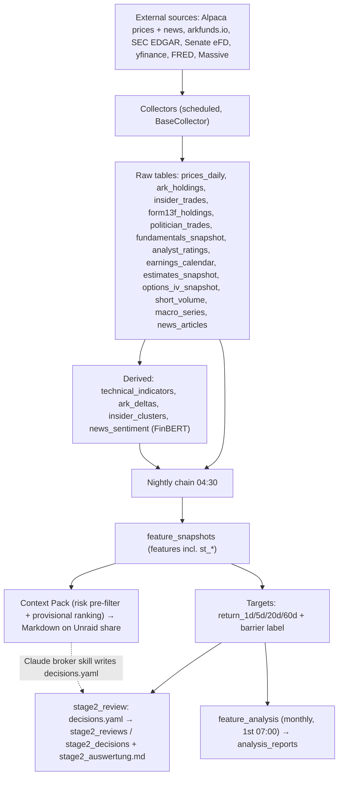
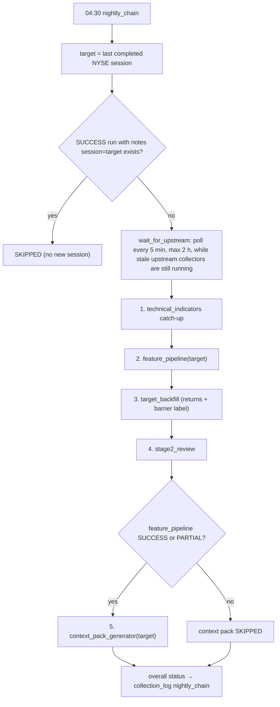

# ARCHITECTURE.md – Technical Architecture

> System architecture, deployment topology, project structure, and data flow.
> For database schema details, see [DATABASE.md](DATABASE.md).
> For execution schedule (all job times), see [SCHEDULER.md](SCHEDULER.md).
> For data sources, APIs and rate limits, see [DATA_SOURCES.md](DATA_SOURCES.md).
>
> See also: [INDEX.md](INDEX.md)

**Last updated:** October 2026

---

## Deployment Topology

```
┌─────────────────────────────────────────────────────────────┐
│  Windows Machine (Development)                              │
│  ├─ VS Code + Claude Code / Antigravity                     │
│  └─ Git Client → GitHub (sebastianganser/Alpaca-Broker)     │
└────────────────────────┬────────────────────────────────────┘
                         │ git push  →  git pull on Unraid
                         ▼
┌──────────────────────────────────────────────────────────────────────┐
│  Unraid Server (Production) – 192.168.1.93                           │
│                                                                      │
│  ┌──────────────────────────────┐     ┌────────────────────────────┐ │
│  │ alpaca-broker (ONE container)│     │ postgresql18-alpaca        │ │
│  │ user 99:100 (nobody:users)   │────▶│ (separate container,       │ │
│  │                              │     │  not managed by this repo) │ │
│  │ uvicorn / FastAPI  :8090     │     │ PostgreSQL 18, port 5435   │ │
│  │ + APScheduler                │     │ DB: broker_data            │ │
│  │   (BackgroundScheduler)      │     │ Schema: signals            │ │
│  │ + React SPA (frontend/dist)  │     └────────────────────────────┘ │
│  │ + FinBERT model (in image)   │                                    │
│  └──────────────┬───────────────┘                                    │
│                 │ bind mount                                         │
│                 ▼                                                    │
│  /mnt/user/Workfiles/AlpacaBroker/context_packs/  (Context Packs,    │
│                                    decisions.yaml, stage-2 report)   │
└──────────────────────────────────────────────────────────────────────┘
          │ HTTPS (outbound only)
          ▼
  Alpaca (Paper Trading ONLY – Market Data + News), SEC EDGAR, arkfunds.io,
  Senate eFD, yfinance, FRED, Massive (ex-Polygon), OpenFIGI, Wikipedia
  → details: DATA_SOURCES.md
```

### Container

| Aspect | Implementation |
|--------|----------------|
| Compose file | [infra/docker-compose.yml](../infra/docker-compose.yml) – only the service `alpaca-broker` (image `alpaca-broker:latest`); the DB runs separately |
| Port | `8090:8090` (API + UI); health endpoint `GET /api/v1/health` |
| Env | `env_file: /mnt/user/appdata/alpaca-broker/.env`, `TZ=Europe/Berlin` (all job times are Berlin time) |
| Volume | `/mnt/user/Workfiles/AlpacaBroker` → same path in the container; `CONTEXT_PACK_PATH` defaults to `/mnt/user/Workfiles/AlpacaBroker/context_packs` |
| Shutdown | `stop_grace_period: 40s`; the FastAPI lifespan waits up to 25 s for running jobs (`SHUTDOWN_TIMEOUT_SECONDS`), runs still `running` afterwards are marked stale on next start |
| Logging | Docker `json-file`, 3 × 10 MB |

**[infra/Dockerfile.collector](../infra/Dockerfile.collector)** – multi-stage build:

1. `node:20-alpine` – `npm ci` + `npm run build` of the React SPA → `frontend/dist`
2. `python:3.12-slim` + pinned `uv` (0.11.2) – `uv sync --frozen`, copies `src/`, `scripts/`, `alembic.ini`; pre-downloads the FinBERT model (`ProsusAI/finbert`) into `/app/.cache/huggingface`
3. `python:3.12-slim` runtime – `postgresql-client` (for `pg_isready`), non-root user **`99:100`** (`APP_UID`/`APP_GID` build args, Unraid `nobody:users`), `HEALTHCHECK` every 60 s against `http://localhost:8090/api/v1/health` (start period 120 s; the endpoint returns 503 if the scheduler is not running or the DB is unreachable)

`CMD` = `.venv/bin/python -m trading_signals.main` (uvicorn on `0.0.0.0:8090`).

**[infra/entrypoint.sh](../infra/entrypoint.sh)**: waits for the DB (`pg_isready` on `DB_HOST:DB_PORT`) → `alembic upgrade head` (**fails hard** – the container exits and `restart: unless-stopped` retries) → `exec` CMD.

**Startup sequence** ([main.py](../src/trading_signals/main.py) lifespan): `validate_alpaca_safety()` (refuses to start if `ALPACA_ENDPOINT` does not contain `paper`) → `create_scheduler()` → job tracker + alert listeners → `scheduler.start()` → `mark_stale_runs()` → `schedule_startup_catchup()`.

### Deploy Workflow

```bash
ssh unraid
cd /mnt/user/appdata/alpaca-broker && git pull
# then either: Compose Manager → Stack "Alpaca-Broker" → Compose Down → Compose Up (rebuild)
# or directly:
docker compose -f /boot/config/plugins/compose.manager/projects/Alpaca-Broker/docker-compose.yml up --build -d
```

Migrations run automatically on container start. [scripts/repair/deploy_review_fixes.sh](../scripts/repair/deploy_review_fixes.sh) is a one-off helper from the 2026-10-05 review (git pull → rebuild → wait for `healthy` → repair scripts in the container); it is not the regular deploy path.

**Network:** the container connects to PostgreSQL via host IP (`DB_HOST` default `192.168.1.93`, `DB_PORT` default `5435`).
**Backup:** by decision (2026-10-05, CLAUDE.md principle 2) **no database backups** are kept; the warehouse is a rolling 20-quarter window. Older docs mentioned a daily `pg_dump` cron on Unraid – whether such a cron still exists on the server is not visible from this repo.
**In production since:** 13 April 2026.

---

## Project Structure

```
Alpaca-Broker/
├── CLAUDE.md / README.md            # Project entry point / GitHub overview
├── docs/                            # Documentation (INDEX.md = navigator)
│   ├── STAGE2_DECISIONS.md          # decisions.yaml format (stage-2 forward test)
│   ├── 2026-10-06_Konzept_Kurzfrist_Kandidaten.md  # short-term candidate concept
│   └── reports/                     # Research reports (event studies, walk-forward, …)
├── infra/
│   ├── docker-compose.yml           # Service alpaca-broker only (DB runs separately)
│   ├── Dockerfile.collector         # 3-stage build (Node → uv/Python → slim runtime, user 99:100)
│   └── entrypoint.sh                # pg_isready → alembic upgrade head → CMD
├── src/
│   ├── alembic/versions/            # Migrations 001–035
│   └── trading_signals/             # Python package (see below)
├── scripts/                         # Run manually (locally or via docker exec)
│   ├── repair/                      # One-off repairs/backfills (features_rebuild, refetch prices,
│   │                                #   backfill_short_term_features, form13f_resolve_tickers, …)
│   ├── analysis/                    # Research: backtest_barrier, walkforward_hit_model,
│   │                                #   event_study, collect_buyback_events
│   ├── archive/                     # Obsolete one-time scripts (kept for reference)
│   ├── sprint10_readiness.py        # Data-maturity check for the scoring model
│   └── *.py                         # Universe init/sync/validate, recompute helpers, backfills
├── notebooks/                       # Exploratory analyses (01–03, plain .py)
├── frontend/                        # Vite + React SPA (built into the image)
│   └── src/  App.tsx, Layout.tsx, api.ts, queries.ts, components/, hooks/,
│             pages/ Dashboard, Universe, Signals (ARK/Insider/Politician/Ratings/Sentiment tabs),
│                    Features, Logs, Settings (scheduler, backfill, API key), Ticker
├── tests/
│   ├── unit/                        # ~50 test modules (pytest)
│   └── fixtures/
├── pyproject.toml / uv.lock / .python-version (3.12)
├── alembic.ini
└── .env.example                     # Template – real values only in .env (never committed)
```

### `src/trading_signals/`

```
trading_signals/
├── main.py                 # FastAPI app + lifespan (scheduler start/stop, catch-up), /api/v1/health, SPA fallback
├── config.py               # Pydantic Settings (DB, Alpaca paper endpoint + safety check, API keys,
│                           #   CONTEXT_PACK_PATH, API_KEY, ALERT_WEBHOOK_URL, LOG_LEVEL)
├── api/
│   ├── deps.py             # DB session, scheduler DI, require_write_access (X-API-Key / X-Requested-With)
│   ├── job_tracker.py      # APScheduler listener → currently running job ids for the UI
│   ├── schemas.py          # Pydantic response schemas
│   ├── serializers.py      # Shared ORM → schema serializers (/signals and /ticker)
│   ├── tasks.py            # BackfillManager (background threads with progress)
│   └── routes/             # dashboard, universe, signals, ticker, features, logs,
│                           #   operations (/ops/*), analysis (/analysis/*)
├── collectors/             # One module per source; BaseCollector subclasses log + alert themselves
│   ├── base.py             # Template method: gaps → fetch → store → collection_log
│   ├── _db.py / _parsing.py# Shared bulk-upsert / parsing helpers
│   ├── gap_detector.py     # Missing trading days: refetch, else forward-fill (is_extrapolated)
│   ├── prices_alpaca.py    # Daily OHLCV (Alpaca, SIP feed, IEX fallback); triggers recompute on re-adjustment
│   ├── ark_holdings.py     # ARK ETF holdings (arkfunds.io) + universe expansion
│   ├── sec_client.py       # SEC EDGAR client (rate limit, CIK mapping)
│   ├── form4_collector.py  # Insider trades (Form 4)
│   ├── form13f_collector.py# Institutional holdings (13F-HR, top filers)
│   ├── cusip_resolver.py   # CUSIP → ticker (cusip_map cache, local tables, OpenFIGI)
│   ├── disclosure_client.py / politician_trades_collector.py  # Senate eFD PTRs
│   ├── yfinance_client.py  # Shared yfinance client (rate limit, batching, backoff)
│   ├── fundamentals_collector.py / analyst_ratings_collector.py /
│   │   earnings_calendar_collector.py / estimates_collector.py   # yfinance sources
│   ├── options_iv_collector.py   # ATM IV, skew, term structure, put/call OI (yfinance)
│   ├── short_interest_collector.py # Short volume (Massive API, ex-Polygon)
│   ├── fred_collector.py   # 6 FRED macro series
│   ├── news_collector.py   # Alpaca News API (Benzinga)
│   └── buyback_events.py   # 8-K buyback authorizations (EDGAR full-text) – research only,
│                           #   used by scripts/analysis, not scheduled
├── derived/
│   ├── technical_indicators.py   # SMA/EMA/RSI/MACD/Bollinger/ATR/RS vs SPY (catch-up logic)
│   ├── ark_deltas.py             # ARK position changes (after ark_holdings)
│   ├── insider_clusters.py       # Cluster buys (after form4)
│   ├── sentiment_scorer.py       # FinBERTScorer (CPU) behind a SentimentScorer ABC
│   ├── sentiment_computer.py     # Scores unscored articles → news_sentiment
│   ├── short_term_features.py    # 9 st_* price features (1–14 session horizon)
│   ├── feature_pipeline.py       # ~95 features / 17 groups (incl. st_*) per PIT-universe ticker and session
│   ├── target_backfill.py        # Forward returns 1/5/20/60d + barrier label (return_barrier_14d, …)
│   ├── recompute.py              # Recompute TA, targets, st_* after a price-history refresh
│   ├── context_pack_generator.py # Stage-1 risk pre-filter + provisional ranking → Markdown packs
│   └── stage2_decisions.py       # Reads/validates decisions.yaml → stage2_reviews / stage2_decisions
├── analysis/
│   ├── feature_report.py   # Monthly FeatureAnalysisEngine (daily rank IC, excess returns) → analysis_reports
│   ├── stats.py / modeling.py / feature_groups.py  # Pure stats, leakage-safe RF+LASSO, feature grouping
│   ├── barrier.py          # Barrier trade simulation (MAIN_BARRIER: +1 % / −2 % / 14 sessions)
│   ├── hit_model.py        # Walk-forward hit-probability model (building blocks)
│   ├── event_study.py      # Event studies on the barrier trade (building blocks)
│   └── stage2_eval.py      # Stage-2 forward-test evaluation + report (stage2_auswertung.md)
├── scheduler/
│   ├── setup.py            # JOB_DEFINITIONS (cron, Europe/Berlin) + create_scheduler()
│   ├── registry.py         # job id ↔ collector_name, CHAIN_STEP_JOB_IDS, NIGHTLY_UPSTREAM, CATCHUP_JOBS
│   ├── runner.py           # run_logged_job, mark_stale_runs, startup catch-up, alert listeners
│   ├── jobs.py             # Job functions incl. run_nightly_chain, retention, feature_analysis
│   └── sector_enrichment.py# Sector/industry via yfinance (index_sync + UI backfill)
├── universe/
│   ├── manager.py          # Universe CRUD + get_universe_as_of (point-in-time universe)
│   ├── index_sync.py       # S&P 500 / Nasdaq 100 membership (Wikipedia)
│   ├── wikipedia_index_history.py  # Historical membership intervals
│   ├── alpaca_validator.py / onboarder.py / blacklist.py  # Tradeability, auto-onboarding, ETF filter
├── data/congress_members.py# Static Congress member → party mapping
├── db/
│   ├── base.py             # Declarative base (schema signals), now_local()
│   ├── session.py          # Engine + session factory
│   └── models/             # ORM models (one module per domain, see DATABASE.md)
└── utils/
    ├── market_calendar.py  # NYSE calendar: trading_days, last_completed_session, …
    ├── job_status.py       # Canonical collection_log statuses
    ├── alerting.py         # notify_run_status → ALERT_WEBHOOK_URL (ntfy)
    ├── retention.py        # DATA_RETENTION_QUARTERS = 20, data_start_date(), quarter_cutoff()
    ├── logging.py          # Logging setup, secret redaction, CollectorLogCapture
    └── retry.py            # Retry with exponential backoff (429/5xx, Retry-After)
```

---

## Data Flow



Universe maintenance runs alongside: `index_sync` (monthly) maintains `universe` + `index_membership`; ARK/politician collectors onboard new tickers via `universe/onboarder.py`; 13F CUSIPs are resolved via `cusip_map`.

**Point-in-time universe:** the feature pipeline computes snapshots for `UniverseManager.get_universe_as_of(d)` = tickers with an `index_membership` interval containing `d` (`valid_from <= d < valid_to`), **∪** universe tickers held by an ARK ETF in the 30 days before `d` (`ARK_UNIVERSE_WINDOW_DAYS`). Without any membership data it falls back to `is_active = TRUE`. The point-in-time rules per source are documented in the module docstring of [feature_pipeline.py](../src/trading_signals/derived/feature_pipeline.py).

### Nightly Chain

Defined in [scheduler/jobs.py](../src/trading_signals/scheduler/jobs.py) (`run_nightly_chain`) and [scheduler/registry.py](../src/trading_signals/scheduler/registry.py). Scheduled daily at **04:30 Europe/Berlin**, after all upstream collectors of the night (times: [SCHEDULER.md](SCHEDULER.md)).



- **Target session** = `market_calendar.last_completed_session()` (not `today − 1`; the container runs in Berlin time).
- **Upstream check** (`NIGHTLY_UPSTREAM`): `prices_alpaca`, `options_iv_collector`, `short_interest_collector`, `fred_collector`, `estimates_collector`, `analyst_ratings_collector`, `ark_holdings`, `form4_collector`, `news_alpaca`, `sentiment_computer`. A collector is fresh if it has a `success`/`partial` run that started after 16:00 ET of the target session. The chain only waits while stale collectors are still `running`; afterwards it proceeds and records them as `stale inputs`. (`prices_alpaca` is flagged critical in the registry, but the chain currently treats every stale input the same → `partial`.)
- **Steps** each run through `run_logged_job(..., alert=False)` and get their own `collection_log` row. `feature_pipeline` writing 0 rows → `skipped`; `target_backfill` retries up to 3× on PostgreSQL deadlocks; `stage2_review` runs after the label update so newly closed trades are counted.
- **Overall status:** `failed` if the feature pipeline failed; `partial` if inputs were stale or any step was not `success`; else `success`. Notes contain `session=YYYY-MM-DD; <step>=<status>, …`. Only the chain itself alerts.
- **Chain step jobs** (`feature_pipeline`, `target_backfill`, `stage2_review`, `context_pack_generator`, see `CHAIN_STEP_JOB_IDS`) are registered **paused** (`next_run_time=None`): visible and manually triggerable in the UI, but never fire on their own. A per-`collector_name` lock in `run_logged_job` prevents a manual trigger and the chain from running the same step concurrently (→ `skipped`).

---

## Context Pack Output (Unraid share)

Written by [derived/context_pack_generator.py](../src/trading_signals/derived/context_pack_generator.py) and the `stage2_review` step below `CONTEXT_PACK_PATH` (default `/mnt/user/Workfiles/AlpacaBroker/context_packs`):

```
context_packs/
├── stage2_auswertung.md          # Stage-2 forward-test report, rewritten on every stage2_review run
└── 2026-10-14/                   # one folder per market session (target session, ISO date)
    ├── 00_uebersicht.md          # overview: ranking, market context, exclusions, data quality,
    │                             #   decisions.yaml template
    ├── 01_<TICKER>.md            # top candidates (default top 5), rank-prefixed
    ├── 02_<TICKER>.md
    ├── …
    └── decisions.yaml            # written by the Claude broker skill, read by stage2_review
```

- **Selection:** stage-1 risk pre-filter (dollar volume > 0, `atr_14_pct` between 1 % and 3 %, no earnings within 21 calendar days, ≥ 3 contributing features), then sorted by a **provisional, unvalidated** rank-based score (`PRELIMINARY_WEIGHTS`).
- **Candidate files:** YAML frontmatter (`ticker`, `as_of`, `rank`, `preliminary_score`, `universe_size`, `sector`, `industry`, optional `close`/`adv_20d_musd`/`earnings_in_days`/`atr_14_pct`/`index_added`, **`selection: risk_prefilter`**, **`ranking_validated: false`**, `data_completeness`) + Markdown body with feature values and percentiles.
- **Encoding:** all files (packs and `stage2_auswertung.md`) are written as `utf-8-sig` (UTF-8 with BOM).
- **Re-runs:** old `NN_*.md` candidate files of the same day are deleted before writing; the overview is written even on days without eligible candidates.
- **Stage 2:** `stage2_review` scans the session folders of the last 45 days (`LOOKBACK_DAYS`) for `decisions.yaml` (schema `stage2-decisions/v1`, format: [STAGE2_DECISIONS.md](STAGE2_DECISIONS.md)), stores them in `stage2_reviews` / `stage2_decisions`, evaluates `buy` decisions with the barrier label and writes `stage2_auswertung.md`. Invalid files → run status `partial` (alert).

> [!IMPORTANT]
> **File permissions:** the container runs as `99:100`. The host directory must be owned by `99:100`:
> `chown -R 99:100 /mnt/user/Workfiles/AlpacaBroker`.
> Running scripts via `docker exec -u root …` creates root-owned files/folders that the app later cannot overwrite (e.g. a session folder or `stage2_auswertung.md`) – run scripts as the default container user, or re-`chown` afterwards. (The compose file contains a commented-out `user: "0:0"` fallback; fixing ownership is the preferred solution.)

---

## Cross-Cutting Concerns

### Job execution & `collection_log`

- **Collector jobs** (`BaseCollector` subclasses) write their own `collection_log` row and alert themselves (wrapped by `_run_collector` in `jobs.py`; missing API keys → `skipped` for FRED / options IV).
- **All other jobs** (derived computations, chain, retention, feature analysis) run through `run_logged_job` ([scheduler/runner.py](../src/trading_signals/scheduler/runner.py)): inserts a `running` row, captures log lines into `collection_log.log_lines` (secrets redacted), catches exceptions → `failed`, finalizes status/records/notes, sends alerts.
- **Statuses** ([utils/job_status.py](../src/trading_signals/utils/job_status.py)): `running`, `success`, `partial`, `failed`, `skipped`; legacy values (`error`, `complete`, `completed`) are normalized. `registry.JOB_COLLECTOR_NAMES` maps scheduler job ids to `collector_name` (e.g. `price_collector` → `prices_alpaca`, `news_collector` → `news_alpaca`, `fundamentals_collector` → `fundamentals_yf`).
- **Stale runs:** rows still `running` after 6 h are set to `failed` (`stale: process restart`) at startup and by the daily `log_retention` job.

### Alerting

[utils/alerting.py](../src/trading_signals/utils/alerting.py): `notify_run_status` POSTs a plain-text message to `ALERT_WEBHOOK_URL` (ntfy-compatible) for `partial`/`failed` runs; without a URL alerts are only logged, and alerting never raises. Additionally APScheduler listeners alert on uncaught job exceptions (`EVENT_JOB_ERROR`) and missed runs (`EVENT_JOB_MISSED`).

### Startup catch-up

The job store is in-memory, so APScheduler cannot detect misfires across restarts. `schedule_startup_catchup` re-runs the jobs in `CATCHUP_JOBS` once if their last scheduled fire time passed without a `success`/`partial`/`skipped` run and the next regular run is more than 1 h away: `price_collector` (+2 min), `estimates_collector` (+4 min, rolling 90-day revision window), `nightly_chain` (+15 min; waits for upstream itself).

### Retention

- **Data retention** (weekly, Sunday 03:00): keeps the last **20 calendar quarters** (`DATA_RETENTION_QUARTERS`, cutoff `quarter_cutoff(20)`). Deletes per table in its own savepoint; excludes `earnings_calendar`, `collection_log`, `universe`, `ticker_blacklist`, `index_membership`. Backfills must use `retention.data_start_date()` and never collect data before the window.
- **Log retention** (daily 03:30): deletes `collection_log` rows older than **90 days** and marks stale runs.

### API security

GET/HEAD/OPTIONS requests are always allowed. Mutating requests on the `operations` (`/api/v1/ops/*`) and `analysis` routers (e.g. `POST /analysis/trigger`) require `X-API-Key` matching `API_KEY` if configured, otherwise the header `X-Requested-With` (CSRF guard) – see `require_write_access` in [api/deps.py](../src/trading_signals/api/deps.py). The API key can be entered in the UI (Settings → API key card).

### Trading safety

Paper trading only: `Settings.validate_alpaca_safety()` aborts startup if `ALPACA_ENDPOINT` does not contain `paper`. The system collects data and produces research output; it does not place orders.

---

## Key Technical Decisions

For detailed rationale behind all decisions, see:
- [DECISIONS_ARCHITECTURE.md](DECISIONS_ARCHITECTURE.md) – Infrastructure & deployment
- [DECISIONS_DATA.md](DECISIONS_DATA.md) – Data sources & collectors
- [DECISIONS_FEATURES.md](DECISIONS_FEATURES.md) – Features & trading strategy
- [2026-10-06_Konzept_Kurzfrist_Kandidaten.md](2026-10-06_Konzept_Kurzfrist_Kandidaten.md) – Short-term candidate concept (barrier trade, risk pre-filter, stage 2)
